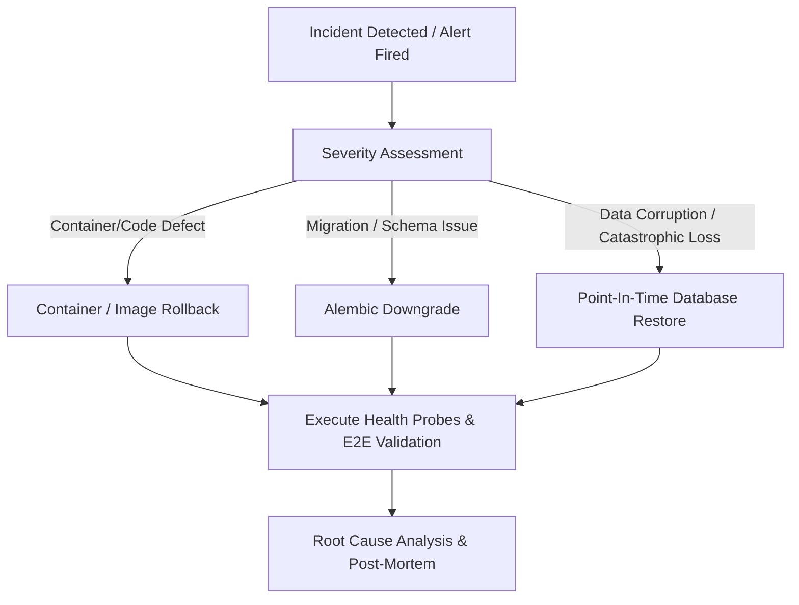

# Production Rollback & Incident Recovery Guide

**System:** AI Editorial Workspace  
**Document Classification:** Operations Runbook / Tier 1 Reliability Engineering  
**Version:** 1.0.0  
**Target Audience:** SREs, DevOps Engineers, On-Call Engineers, Release Managers  

---

## 1. Executive Summary & Rollback Philosophy

In mission-critical enterprise editorial environments, service degradation or data corruption must be resolved within predetermined Service Level Objectives (SLOs):
- **Maximum Tolerable Downtime (MTD):** < 15 minutes
- **Recovery Point Objective (RPO):** < 1 hour
- **Recovery Time Objective (RTO):** < 10 minutes

This runbook establishes strict, step-by-step procedures for reverting the application to a known stable state across three failure domains:
1. **Application Layer (Frontend / Backend Container Failure)**
2. **Schema & Migration Layer (Alembic DDL Failure)**
3. **Data Layer (PostgreSQL State Corruption or Hardware Failure)**



---

## 2. Decision Matrix: Roll Forward vs. Roll Back

| Scenario | Primary Indicator | Recommended Action | Typical Execution Time |
| :--- | :--- | :--- | :--- |
| **5xx Error Spike (>1%)** | Splunk / Dynatrace error rate alert | Container rollback to `v1.0.0-rcX` | < 3 minutes |
| **P95 Latency Degradation (>2s)** | Real User Monitoring (RUM) alert | Scale backend pods / Roll back release | < 5 minutes |
| **Schema Migration Failure** | Backend crash loop `Alembic error` | Alembic `downgrade -1` or target revision | < 5 minutes |
| **Database Data Corruption** | Foreign key inconsistencies, lost drafts | PostgreSQL PITR from continuous WAL/pg_dump | 15–30 minutes |
| **Environment Variable Misconfig** | Decryption failure on LLM keys | Re-inject verified secret from vault | < 2 minutes |

---

## 3. Container & Application Layer Rollback

### 3.1 Docker Compose Deployment Rollback

When a newly deployed container image exhibits regressions, revert immediately to the previous tagged image:

```bash
# 1. Inspect running container tags and states
docker compose ps

# 2. Check previous container image tag in local registry
docker images | grep editorial

# 3. Modify docker-compose.prod.yml or export previous version tag
export APP_VERSION=v0.9.9

# 4. Trigger atomic container recreation
docker compose -f docker-compose.prod.yml up -d --no-deps --force-recreate backend frontend

# 5. Verify healthy container status
docker compose -f docker-compose.prod.yml ps
curl -fsS http://localhost:8000/health/live || exit 1
```

### 3.2 Kubernetes / Cloud Platform Rollback

#### Kubernetes (EKS / GKE / AKS)
```bash
# View rollout history for editorial backend
kubectl rollout history deployment/editorial-backend -n editorial-prod

# Roll back to immediate previous revision
kubectl rollout undo deployment/editorial-backend -n editorial-prod

# Or roll back to a specific validated revision
kubectl rollout undo deployment/editorial-backend --to-revision=14 -n editorial-prod

# Monitor rollback status until complete
kubectl rollout status deployment/editorial-backend -n editorial-prod --timeout=120s
```

#### Managed Cloud (Render / Railway / Fly.io)
- **Railway:** Navigate to Project -> **Deployments** -> Locate previous successful deployment commit -> Click **Rollback to this deployment**.
- **Fly.io:**
  ```bash
  fly releases list
  fly deploy --image registry.fly.io/editorial-workspace:v0.9.9
  ```

---

## 4. Database Schema Rollback (Alembic)

Every Alembic migration script in `backend/alembic/versions/` is strictly required to implement bidirectional DDL transformations (`upgrade()` and `downgrade()`).

### 4.1 Single Step Downgrade
If the latest migration causes schema lock contention or unexpected query regressions:

```bash
# Activate production virtual environment or exec into backend container
docker compose exec backend bash

# Inspect current revision head
alembic -c backend/alembic.ini current

# Downgrade by exactly one revision
alembic -c backend/alembic.ini downgrade -1

# Verify new schema revision
alembic -c backend/alembic.ini current
```

### 4.2 Target Revision Downgrade
To revert to a known stable milestone (e.g., baseline `7a2c3d4e5f6a`):

```bash
alembic -c backend/alembic.ini downgrade 7a2c3d4e5f6a
```

### 4.3 Handling Irreversible Migrations
> [!CAUTION]
> If a migration dropped a column or table without a soft-deletion phase, standard `alembic downgrade` will regenerate the column with `NULL` data. In this scenario, do **not** rely on DDL downgrade alone; execute a point-in-time database restore as documented in Section 5.

---

## 5. PostgreSQL Disaster Recovery & Data Restoration

### 5.1 Restoring from Daily Atomic Dump (`pg_dump`)

Daily automated logical dumps are stored in compressed format: `/var/backups/editorial/editorial_db_YYYYMMDD_HHMMSS.dump`.

```bash
# Step 1: Drain active user traffic by setting maintenance mode in Nginx
sudo cp /etc/nginx/conf.d/maintenance.html /var/www/html/index.html
sudo nginx -s reload

# Step 2: Terminate active connections to PostgreSQL
sudo -u postgres psql -c "
SELECT pg_terminate_backend(pid) 
FROM pg_stat_activity 
WHERE datname = 'editorial_workspace' AND pid <> pg_backend_pid();"

# Step 3: Drop and recreate database
sudo -u postgres psql -c "DROP DATABASE editorial_workspace;"
sudo -u postgres psql -c "CREATE DATABASE editorial_workspace OWNER editorial_user;"

# Step 4: Restore from validated backup file
pg_restore -U editorial_user -d editorial_workspace \
  -h localhost -p 5432 \
  --verbose --clean --no-acl --no-owner \
  /var/backups/editorial/editorial_db_20261109_000000.dump

# Step 5: Verify table counts and integrity
psql -U editorial_user -d editorial_workspace -c "
SELECT count(*) FROM workspaces;
SELECT count(*) FROM sources;
SELECT count(*) FROM research_projects;
SELECT count(*) FROM writing_drafts;"

# Step 6: Disable maintenance mode
sudo rm /var/www/html/index.html
sudo nginx -s reload
```

---

## 6. Post-Rollback Verification & Smoke Testing

Immediately after executing a rollback, execute the smoke verification suite to confirm service restoration:

```bash
# 1. Check Liveness Probe (Expect 200 OK {"status": "ok"})
curl -i http://localhost:8000/health/live

# 2. Check Readiness Probe (Expect 200 OK {"status": "ready", "database": "connected"})
curl -i http://localhost:8000/health/ready

# 3. Validate Frontend Asset Delivery
curl -I http://localhost/index.html

# 4. Run automated headless smoke test
PYTHONPATH=. backend/venv/Scripts/python.exe -m pytest backend/tests/test_phase13_master_integration.py -k "test_scenario_1_dashboard"
```

---

## 7. Incident Escalation & Post-Mortem Procedure

Following any production rollback event:
1. **Lock Artifacts:** Snapshot container logs, PostgreSQL error logs, and metrics graphs.
2. **Post-Incident Review Meeting:** Convene within 24 hours with Lead Architect, DevOps, and Product Manager.
3. **Root Cause Analysis (RCA):** Complete standard 5-Whys analysis template.
4. **Remediation Action Items:** Log corrective tickets in issue tracker prior to re-attempting release.

