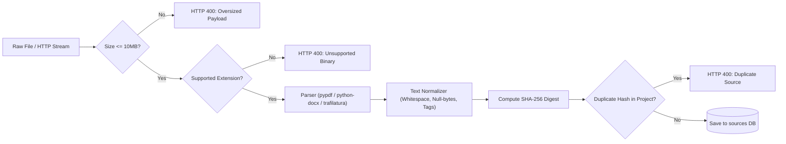

# Source Ingestion Pipeline Specification & Security Hardening

## 1. Overview

The **Source Ingestion Pipeline** handles multi-modal ingestion of research literature, industry articles, press releases, and documents into the **AI Editorial Workspace**. It guarantees high-fidelity text extraction, defensive SSRF mitigation, file size bounding, text normalization, and cryptographic deduplication.

---

## 2. Ingestion Modes & Capabilities

| Ingestion Mode | Input Mechanism | Maximum Size | Supported Formats |
| :--- | :--- | :--- | :--- |
| **Web Article URL** | HTTP / HTTPS URL string | 2 MB HTTP response | HTML, XHTML, XML, Text |
| **Document Upload** | Multipart Form Data | 10 MB file bytes | `.pdf`, `.docx`, `.doc`, `.txt`, `.md`, `.csv`, `.json` |
| **Visual Media** | Multipart Form Data | 10 MB file bytes | `.png`, `.jpg`, `.jpeg`, `.webp`, `.bmp`, `.gif` |
| **Verbatim Paste** | Direct textarea submission | 500,000 characters | UTF-8 Plaintext / Markdown |

---

## 3. Defense-in-Depth SSRF Guardrails

Web extraction accepts untrusted URLs from end users. To defend against Server-Side Request Forgery (SSRF) attacks targeting cloud metadata, local microservices, or private network boundaries, the pipeline enforces multi-layered checks:

### 3.1 Hostname & Address Blocklist
The following addresses are blocked unconditionally before any network connection is initiated:
- `localhost`, `127.0.0.1`, `0.0.0.0`, `::1`
- Cloud Metadata IPs: `169.254.169.254` (AWS, GCP, Azure), `100.100.100.200` (Alibaba Cloud)
- Cloud Metadata Hostnames: `metadata.google.internal`, `instance-data`, `metadata`
- Private Hostname Suffixes: `.local`, `.internal`, `.localhost`, `.lan`, `.corp`, `.home.arpa`

### 3.2 IP Subnet Validation (RFC 1918 & Reserved)
All resolved IP addresses are audited against:
- `10.0.0.0/8` (Private Class A)
- `172.16.0.0/12` (Private Class B)
- `192.168.0.0/16` (Private Class C)
- `100.64.0.0/10` (Carrier-Grade NAT, RFC 6598)
- `127.0.0.0/8` (Loopback)
- `169.254.0.0/16` (Link-Local)
- `fc00::/7` (IPv6 Unique Local)
- `fe80::/10` (IPv6 Link-Local)

### 3.3 Per-Hop Redirect Validation
HTTP redirects (`301`, `302`, `303`, `307`, `308`) present an attack vector where an initially public domain redirects to an internal IP (e.g., `attacker.com` $\rightarrow$ `169.254.169.254`).
- **Enforcement**: Automatic redirect following is disabled (`follow_redirects=False`).
- Each `Location` header is parsed, sanitized, and audited via `is_safe_url` before the subsequent request is issued.
- Maximum redirect hops: 4 hops.

---

## 4. Cryptographic Content Deduplication

To prevent duplicate sources from skewing synthesis statistics or bloating research projects:
1. **Content Hashing**: Upon extraction or normalization, the system computes the SHA-256 digest of the cleaned body text:
   $$\text{content\_hash} = \text{SHA256}(\text{normalized\_text})$$
2. **Project-Scoped Check**: If an existing source within the same active project already possesses the identical `content_hash`, the addition is rejected with `HTTP 400 Bad Request`:
   `"A source with identical content already exists in this project (duplicate content hash)."`
3. **URL Deduplication**: Identical original or canonical URLs within the project are rejected prior to network extraction.

---

## 5. URL Canonicalization

Tracking parameters and superficial URL variations are removed to avoid artificial duplication:
- **Stripped Parameters**: `utm_source`, `utm_medium`, `utm_campaign`, `utm_term`, `utm_content`, `ref`, `fbclid`, `gclid`, `mc_cid`, `mc_eid`.
- **Normalization**: Hostnames and schemes are lowercased; trailing slashes are removed.
- **Example**:
  $$\text{https://example.com/paper/?utm\_source=twitter\&ref=hackernews} \longrightarrow \text{https://example.com/paper}$$

---

## 6. Document Extraction & Cleaning Pipeline

### Text Normalization Rules
1. **Null Byte Stripping**: All `\x00` characters are eliminated.
2. **Whitespace Collapsing**: Multiple consecutive spaces and tabs are collapsed to a single space.
3. **Carriage Return Conversion**: CRLF (`\r\n`) and CR (`\r`) are converted to standard LF (`\n`).
4. **Blank Line Clamping**: More than two consecutive newlines are clamped to double newlines (`\n\n`), preserving clean paragraph boundaries for citation extraction.

