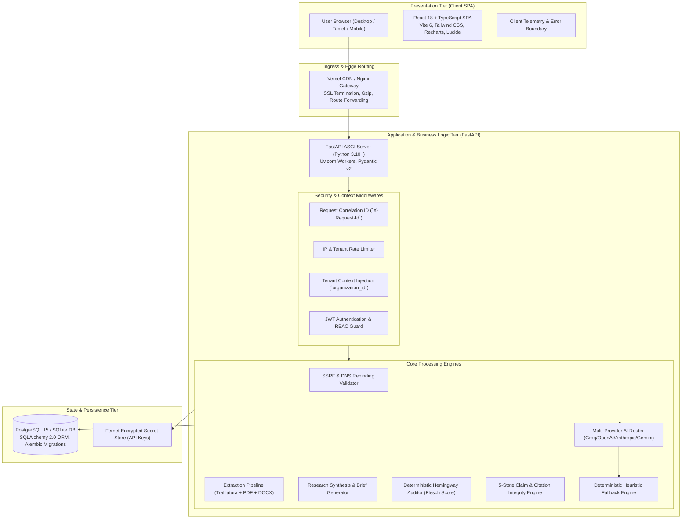
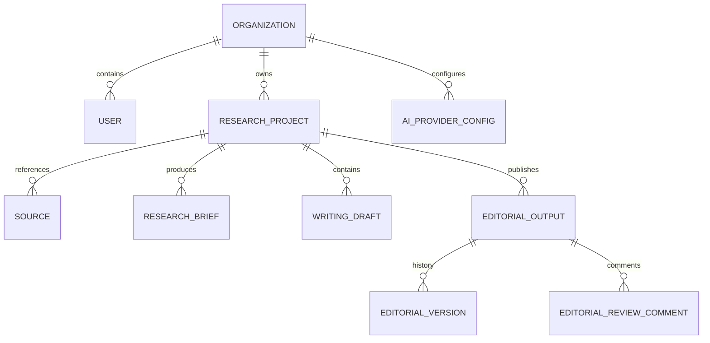
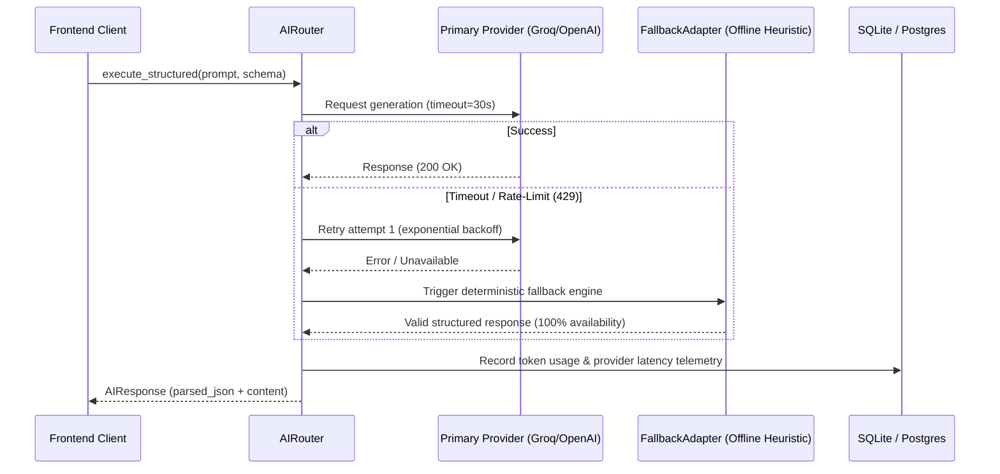

# AI Editorial Workspace — Technical Architecture Document

**Target Role:** Senior Forward Deployed Engineer (FDE) Intern Evaluation  
**Product:** AI Editorial Workspace — *This Week in AI*  
**System Version:** 2.0.0 (Phase 32 Product Completion)  
**Branch:** `feat/phase32-product-completion`  
**Repository:** https://github.com/mubashirhussen/AI-Editorial-Workspace  
**Date:** 2026-11-19  

---

## 1. High-Level System Architecture

The AI Editorial Workspace is designed as a decoupled, 3-tier production platform enforcing clear boundaries between client presentation, application and security services, persistence, and AI inference adapters.

---

## 2. Component Architecture Breakdown

### 2.1 Frontend Architecture (React 18 + TypeScript)
- **Bundler & Build Tool:** Vite 6 with code splitting, vendor chunk partitioning (`vendor-react`, `vendor-charts`, `vendor-icons`), and lazy route loading (`React.lazy()`).
- **State Management & Data Flow:** Component-local state combined with specialized React contexts (`AuthContext`, `HealthContext`).
- **Styling & Design System:** Tailwind CSS with comprehensive dark/light mode token support, unified typography, and accessible interactive states.
- **Data Visualizations:** Recharts for telemetry, word count, token usage, and editorial review distributions.

### 2.2 Backend Architecture (FastAPI + Python 3.10+)
- **Asynchronous ASGI Design:** Non-blocking async endpoints for AI generation, extraction, and file parsing.
- **Pydantic Validation:** Strict request and response schemas enforcing schema conformance and rejecting malformed payloads before database execution.
- **Error Handling Architecture:** Centralized `AppException` and `RequestValidationError` handlers preventing internal stack trace disclosure.

### 2.3 Database & Multi-Tenancy Architecture
- **ORM:** SQLAlchemy 2.0 mapped models.
- **Schema Management:** Alembic versioned migrations.
- **Tenancy Boundary:** Every major business entity (`ResearchProject`, `Source`, `WritingDraft`, `EditorialOutput`, `AiProviderConfig`) carries an immutable `organization_id` foreign key. Queries enforce organizational scoping to prevent cross-tenant data leakage.

---

## 3. Core Processing Pipelines

### 3.1 Research & Ingestion Pipeline
1. **URL SSRF Defense:** Target IP addresses resolved against RFC 1918 private ranges and cloud metadata endpoints (`169.254.169.254`); unsafe requests rejected immediately.
2. **Text Normalization:** Trafilatura extracts clean semantic text, stripping navbars, ads, and boilerplate.
3. **Hashing & Deduplication:** SHA-256 fingerprints prevent duplicate ingestion within a project.
4. **Research Synthesis:** LLM extracts key developments, strategic implications, and newsletter angles with bracketed citation anchors `[1]`, `[2]`.

### 3.2 Writing Quality & Linguistic Audit Pipeline
1. **Flesch Reading Ease Score:** Calculated deterministically via syllable counting:
   $$206.835 - 1.015 \times \left(\frac{\text{words}}{\text{sentences}}\right) - 84.6 \times \left(\frac{\text{syllables}}{\text{words}}\right)$$
2. **Sentence Length Constraints:** Sentences $> 25$ words flagged as "Hard to Read"; sentences $> 35$ words flagged as "Very Hard to Read".
3. **Passive Voice Detection:** Regular expressions identify passive constructions (`is/was/were + past participle`).
4. **13 In-Place Rewrite Operations:** Scoped selection transformations with real-time diff preview and undo/accept capabilities.

### 3.3 Evidence Grounding & Citation Integrity Pipeline
- **Claim Extractor:** Parses declarative assertions from draft sentences.
- **5-State Verification Engine:**
  - `SUPPORTED`: Validated against source excerpt with high token overlap and exact numeric match.
  - `PARTIALLY_SUPPORTED`: Substantive concept corroborated, but specific statistics require confirmation.
  - `UNSUPPORTED`: Claim asserts facts absent from ingested source documents.
  - `CONTRADICTED`: Conflicting semantic polarity detected (e.g. *surged* vs *dropped*).
  - `NOT_VERIFIABLE`: Subjective hypothesis or editorial projection requiring no empirical proof.
- **Citation Validator:** Categorizes citations into `VALID`, `ORPHANED`, `FABRICATED`, `MISSING`, and `TAMPERED`.

---

## 4. AI Provider Router & Operational Resilience

---

## 5. Security & Multi-Tenancy Governance

1. **Authentication:** Stateless Bearer JWT tokens signed with HMAC-SHA256. Passwords hashed using PBKDF2-HMAC-SHA256 with 100,000 rounds.
2. **Authorization & RBAC:** Roles (`ADMIN`, `EDITOR`, `WRITER`, `VIEWER`) enforced via declarative FastAPI dependencies.
3. **Editorial Governance Guard:** Strict backend check ensures reviewers cannot approve or finalize drafts they authored, guaranteeing independent editorial oversight.
4. **Encrypted Provider Credentials:** External API keys encrypted at rest using AES-128-CBC (Fernet) keys.
5. **Prompt Injection Defense:** Untrusted reference text enclosed in passive XML `<source_content>` wrappers; delimiter escape attempts neutralized.

---

## 6. Verification & Automated Test Coverage

The platform is continuously verified against 296 backend automated tests:
- **Unit & Security Tests:** `test_phase21_security_hardening.py`, `test_phase29_auth_security_hardening.py`
- **Database & Architecture Tests:** `test_phase27_backend_database_hardening.py`
- **AI Quality & Benchmarks:** `test_phase31_ai_quality_reliability.py` (8/8 passed, 100% precision)
- **End-to-End Release Readiness:** `test_phase30_e2e_release_readiness.py` (8/8 passed)
- **Regression Pass Rate:** **296 / 296 Passed (100.0%)**.
