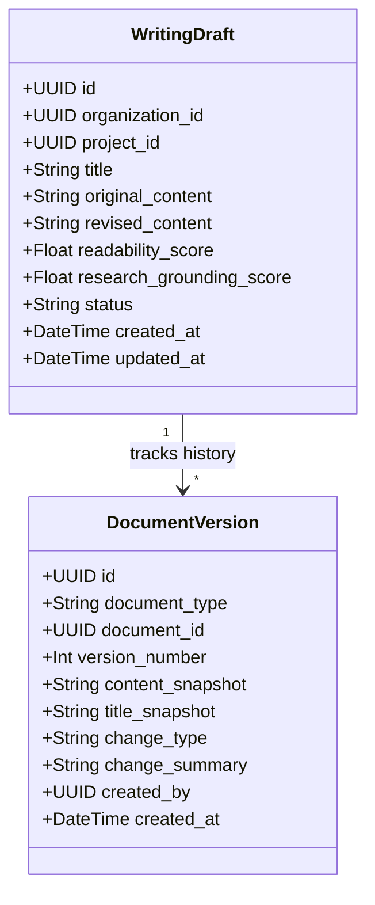

# Version Control & Document Evolution Design

## 1. Design Objectives

Editorial writing is fundamentally iterative. Writers need to experiment with alternative phrasings, accept or reject AI rewrite suggestions, and restore previous iterations without fear of destructive overwrites or lost work.

The AI Editorial Workspace implements an **immutable, append-only snapshot architecture** modeled after Git commit trees, specialized for rich text documents.

---

## 2. Architecture & Data Model

Every document mutation generates a version record linked to the draft:

### Invariants:
1. **Snapshots are Immutable**: Once created, a `DocumentVersion` record is never updated or deleted during document edits.
2. **Sequential Version Numbers**: Version numbers strictly increment monotonically (`v1`, `v2`, `v3`).
3. **Non-Destructive Restoration**: Restoring an earlier version (e.g., reverting to `v1` while currently on `v4`) does not delete `v2`, `v3`, or `v4`. Instead, it appends a new head snapshot (`v5`) whose content matches `v1`, preserving complete auditability.

---

## 3. Snapshot Triggering Events

Version snapshots are automatically recorded on:
- **Initial Creation**: When a draft is created or synthesized via AI.
- **Manual Save / Autosave**: When revised content differs from the previous snapshot.
- **Suggestion Batch Acceptance**: When suggestions are accepted or "Accept All" is executed.
- **Version Restoration**: When a user rolls back to an earlier milestone.

---

## 4. Diff & Comparison Engine

The workspace provides real-time comparison between baseline (original) content and revised content (`GET /api/v1/writing/drafts/{id}/compare`):
- Word count delta ($\Delta \text{Words}$).
- Readability improvement ($\Delta \text{Flesch}$).
- Accepted, rejected, and pending suggestion counts.
- Side-by-side or inline highlighted diff view in the React UI.

