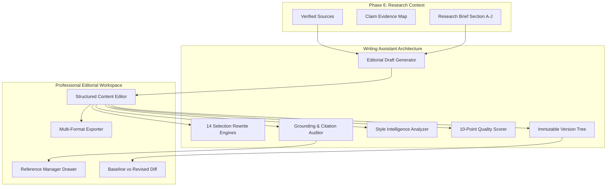

# AI Writing Assistant Architecture

## 1. System Overview

The AI Writing Assistant is an enterprise-grade editorial intelligence system designed for professional technology publications, analyst firms, and editorial teams. It seamlessly bridges evidence-grounded research (Phase 6) with publication-ready draft authoring, selection-based rewriting, transparent quality assessment, style profile enforcement, and non-destructive version control.

---

## 2. Core Architectural Pillars

### A. Grounded Generation & Citation Continuity
Drafts generated from research briefs maintain strict mathematical traceability to source documents. Inline bracketed citations (e.g., `[1]`, `[2]`) are preserved across all operations:
- **Corroborated Facts**: Direct mappings between claims in generated drafts and source excerpt strings.
- **Citation Preservation Invariant**: Every rewriting operation guarantees that existing citation tags `[n]` remain intact in output text.
- **Grounding Audit**: Analyzes drafted text against connected research sources and assigns one of 5 verified statuses:
  - `SUPPORTED`: Direct verbatim or near-verbatim semantic match with source excerpt.
  - `PARTIALLY_SUPPORTED`: Logical inference from documented facts.
  - `UNSUPPORTED`: Claim made without backing evidence in source corpus.
  - `CONTRADICTED`: Claim contradicts verified findings in research corpus.
  - `NOT_VERIFIABLE`: External assertion outside ingested project scope.

### B. 14 Surgical Selection Rewriting Operations
Rather than executing destructive full-document rewrites, the assistant supports 14 focused operations:

| # | Canonical Operation | Purpose & Editorial Objective |
|---|---------------------|-------------------------------|
| 1 | `improve_clarity` | Eliminates passive qualifiers, wordy lead-ins, and semantic ambiguities. |
| 2 | `improve_readability` | Segments compound clauses and optimizes sentence cadence for executive scanability. |
| 3 | `fix_grammar` | Rectifies dangling modifiers, subject-verb disagreements, and typographical errors. |
| 4 | `improve_sentence_structure` | Rebalances clauses, converts passive constructions into active voice. |
| 5 | `reduce_repetition` | Prunes redundant tautologies (`absolutely essential` -> `essential`) and duplicate consecutive tokens. |
| 6 | `improve_transitions` | Inserts logical connective tissue (`Furthermore,`, `Consequently,`) between paragraphs. |
| 7 | `simplify_language` | Translates bureaucratic jargon into direct, authoritative Anglo-Saxon phrasing. |
| 8 | `adjust_tone` | Modulates voice between authoritative analytical, technical, and conversational executive. |
| 9 | `generate_headlines` | Generates punchy, journalistic headlines with analytical subtitle hooks. |
| 10 | `summarize_selection` | Condenses multi-sentence passages into their core thematic thesis. |
| 11 | `expand_content` | Elaborates technical trade-offs with empirical architectural context without fluff. |
| 12 | `rewrite_selection` | Polishes highlighted text into executive publication-ready prose. |
| 13 | `improve_introduction` | Constructs engaging, high-impact introductory hooks for technical leaders. |
| 14 | `improve_conclusion` | Synthesizes strategic implications into enduring, forward-looking takeaways. |

### C. Fallback Architecture & Offline Determinism
The Writing Assistant employs a dual-engine architecture:
1. **Primary AI Engine**: Leverages Claude / GPT-4 / Gemini via structured JSON prompting with schema enforcement.
2. **Deterministic Fallback Engine**: If AI API keys are unavailable, rate-limited, or experience network timeouts, the system automatically falls back to deterministic rule-based algorithms with zero user-facing downtime.

---

## 3. API Contract Specifications

All endpoints follow the `/api/v1/writing` namespace:

- `POST /api/v1/writing/drafts`: Create new writing draft with metadata and initial version snapshot.
- `GET /api/v1/writing/drafts`: List drafts with search, filtering, and tenant isolation.
- `GET /api/v1/writing/drafts/{id}`: Retrieve draft details with suggestions and revision metrics.
- `PUT /api/v1/writing/drafts/{id}`: Update draft content and create version snapshot.
- `POST /api/v1/writing/drafts/{id}/duplicate`: Non-destructively clone draft.
- `DELETE /api/v1/writing/drafts/{id}`: Cascading deletion of draft and suggestion records.
- `POST /api/v1/writing/drafts/generate`: Generate evidence-grounded editorial draft from research brief.
- `POST /api/v1/writing/rewrite-selection`: Execute surgical rewrite on highlighted text span.
- `GET /api/v1/writing/drafts/{id}/grounding-audit`: Perform claim-by-claim factual grounding verification.
- `POST /api/v1/writing/drafts/{id}/style-check`: Audit compliance against active style profile (with safe default fallback).
- `GET /api/v1/writing/drafts/{id}/export`: Export draft to Markdown, Text, Word (`.docx`), or HTML.
- `GET /api/v1/writing/drafts/{id}/versions`: List chronological version snapshots.
- `POST /api/v1/writing/drafts/{id}/restore/{version_id}`: Non-destructively restore snapshot as new head version.
- `GET /api/v1/writing/drafts/{id}/compare`: Side-by-side diff between baseline and revised content.
