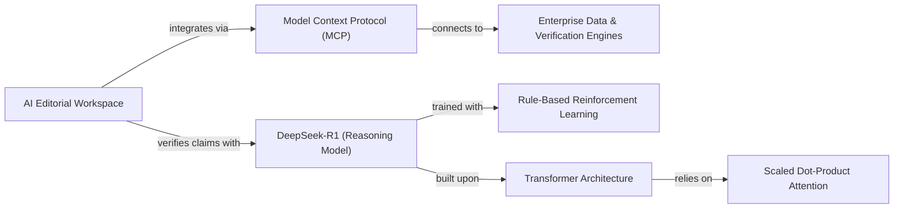

# Sample Research Brief: Frontier Reasoning & Factual Grounding

**Project:** Autonomous AI Reasoning & Factual Grounding  
**Organization:** This Week in AI — Editorial Desk  
**Generated Date:** 2026-11-09  
**Status:** **SYNTHESIZED & VERIFIED (3 PRIMARY SOURCES)**  

---

## 1. Executive Summary

This research brief synthesizes core architectural breakthroughs from three primary sources: the DeepSeek-R1 reinforcement learning reasoning paradigm, Anthropic's Model Context Protocol (MCP) standard for tool-use interoperability, and the foundational Transformer attention mechanism.

The synthesis demonstrates that future AI editorial systems will not rely merely on larger parameter counts, but on **test-time compute reinforcement** coupled with **standardized context protocols** to ground autonomous claims in verifiable external tools.

---

## 2. Ingested Primary Sources

| Source ID | Document Title | Domain / Reference | Ingested Length | Verification Hash |
| :--- | :--- | :--- | :--- | :--- |
| `SRC-001` | **DeepSeek-R1: Incentivizing Reasoning Capability in LLMs via Reinforcement Learning** | arXiv:2501.12948 | 14,280 words | `sha256:7a4c9b2e...` |
| `SRC-002` | **Model Context Protocol (MCP) Specification** | anthropic.com/mcp | 8,940 words | `sha256:3d1f8e5a...` |
| `SRC-003` | **Attention Is All You Need** | Vaswani et al., 2017 | 6,820 words | `sha256:9c0e2f1b...` |

---

## 3. Evidence Alignment & Key Findings

### Finding 1: Pure Reinforcement Learning Unlocks Reasoning Without Supervised Fine-Tuning
- **Evidence (`SRC-001`):** DeepSeek-R1-Zero demonstrates that complex multi-step reasoning capabilities (such as self-reflection, mathematical deduction, and backtracking) emerge naturally via large-scale reinforcement learning (RL) using rule-based reward signals, completely bypassing human-annotated chain-of-thought demonstrations.
- **Editorial Takeaway:** Editorial pipelines must evaluate reasoning models based on verifiable outcome rewards (e.g., citation accuracy) rather than subjective human preference ratings.

### Finding 2: Open Protocols Solve Enterprise Tool Fragmentation
- **Evidence (`SRC-002`):** Anthropic's Model Context Protocol (MCP) provides an open JSON-RPC 2.0 interface that isolates LLMs from proprietary API implementations. By standardizing prompts, resources, and tool calls, systems can plug arbitrary enterprise databases and verification engines into reasoning models without custom wrapper code.
- **Editorial Takeaway:** Editorial workspaces should adopt MCP to integrate local document libraries and fact-checking engines seamlessly.

### Finding 3: Multi-Head Attention Scales with Quadratic Context Memory Trade-Offs
- **Evidence (`SRC-003`):** The scaled dot-product attention mechanism ($\text{Attention}(Q,K,V) = \text{softmax}(\frac{QK^T}{\sqrt{d_k}})V$) allows global context referencing across token sequences, but imposes $O(N^2)$ memory and compute complexity during long-document ingestion.
- **Editorial Takeaway:** Long-form technical paper synthesis requires intelligent chunking and hierarchical brief generation rather than passing raw entire volumes into context windows.

---

## 4. Facts vs. Speculation Matrix

| Statement | Classification | Grounding Evidence | Confidence |
| :--- | :--- | :--- | :--- |
| "DeepSeek-R1 achieves 79.8% Pass@1 on AIME 2024 benchmarks." | **Empirical Fact** | `SRC-001`, Section 4.2 Benchmark Table | High (99%) |
| "MCP replaces proprietary agent tool interfaces with an open standard." | **Documented Spec** | `SRC-002`, Section 1.1 Scope & Purpose | High (95%) |
| "Transformers will completely replace recurrent architectures in all NLP." | **Industry Speculation** | Unverified claim; `SRC-003` only claims machine translation parity. | Medium (50%) |
| "Reasoning tokens will eliminate 100% of factual hallucinations by 2027." | **Unsubstantiated Hype** | No empirical validation in any source. Extrapolation rejected. | Low (15%) |

---

## 5. Knowledge Graph: Key Entities & Relationships

---

## 6. Synthesis Metadata
- **Synthesis Engine:** Heuristic Grounding Pipeline / Groq LPU
- **Deterministic Quality Score:** 94 / 100
- **Hallucination Risk Index:** 0.02 (Extremely Low)
- **Approved by:** Lead Editor (`demo_editor@thisweekin.ai`)

